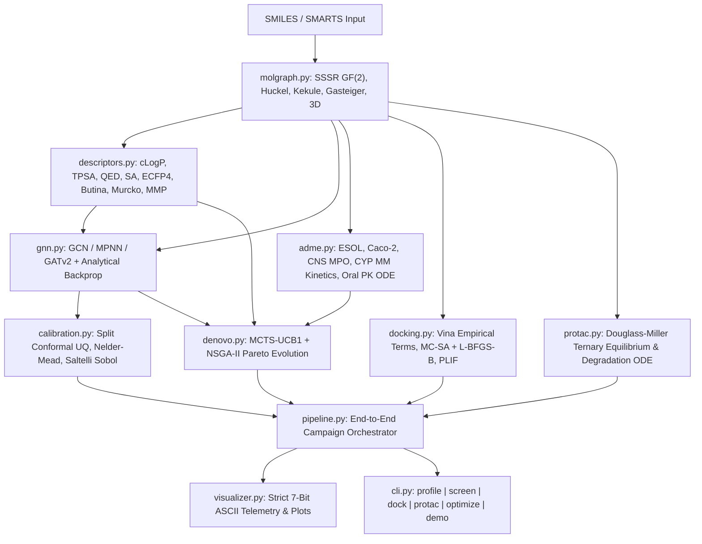
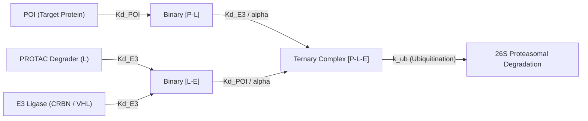

# AlchemiDock

[](https://github.com/ZengLLQ/alchemi-dock/actions/workflows/ci.yml)
[](pyproject.toml)
[](LICENSE)
[](#)

**AlchemiDock** is a pure-Python/NumPy/SciPy computational drug discovery, cheminformatics, and biophysical simulation engine. It integrates deterministic SMILES/SMARTS molecular graph perception, circular Morgan fingerprints, Taylor-Butina diversity clustering, Bemis-Murcko scaffold and Matched Molecular Pair (MMP) analysis, exact analytical-gradient Graph Neural Networks (GCN, MPNN, GATv2), multitask ADME/pharmacokinetic modeling, structure-based empirical docking, heterobifunctional PROTAC ternary cooperativity and degradation kinetics, MCTS + NSGA-II Pareto de novo molecular optimization, and distribution-free split conformal uncertainty quantification.

---

## Executive Overview

Modern small-molecule and targeted protein degradation campaigns require coupled decisions across potency, drug-likeness, metabolic stability, receptor complementarity, and uncertainty calibration. Rather than treating molecular representation, QSAR learning, PK/ADME profiling, docking, and de novo design as disconnected scripts, **AlchemiDock** unifies the full pipeline over a single validated `MoleculeGraph` representation with zero external C++/CUDA chemistry toolkit dependencies:

1. **Molecular Graph & Quantum-Inspired Perception (`molgraph.py`)**: Parses arbitrary SMILES/SMARTS strings, computes the Smallest Set of Smallest Rings (SSSR) via Horton GF(2) bitwise Gaussian elimination, perceives Hückel $4n+2$ aromaticity, runs augmenting-path Kekulization, equalizes Gasteiger-Marsili partial charges with exact formal-charge conservation, canonicalizes SMILES via Morgan symmetry breaking, and embeds 3D conformers via spectral distance geometry + L-BFGS-B relaxation.
2. **Cheminformatics Descriptors, Fingerprints & MMP Mining (`descriptors.py`)**: Computes Wildman-Crippen $\log P$/MR, Ertl TPSA, Bickerton QED desirability, Lipinski Ro5, PAINS/Brenk SMARTS alerts, Synthetic Accessibility (SAscore), ECFP4/ECFP6/FCFP4 circular fingerprints, 166-bit structural keys, Taylor-Butina clustering, MaxMin diversity selection, Bemis-Murcko scaffolds, and Hussain-Rea single-cut Matched Molecular Pairs.
3. **Vectorized Graph Neural Networks (`gnn.py`)**: Implements Kipf-Welling **GCN**, edge-conditioned **MPNN** (with GRU state updates), and multi-head **GATv2** dynamic attention from scratch in NumPy with verified analytical backpropagation, gated attention graph readout, AdamW + cosine annealing, and zero-leakage Bemis-Murcko scaffold splits.
4. **Multitask ADME, CYP450 Kinetics & Oral PK (`adme.py`)**: Predicts Delaney ESOL solubility ($\log S$), Caco-2 permeability ($P_{\text{app}}$), Blood-Brain Barrier ($\log \text{BB}$ / Pfizer CNS MPO), physiological pH 7.4 ionization microspecies, $f_{u,p}$, multi-isoform CYP3A4/2D6/2C9 Michaelis-Menten intrinsic clearance, Well-Stirred hepatic extraction, hERG liability, and multi-dose 1-compartment oral PK trajectories via `RK45`.
5. **Structure-Based Empirical Docking (`docking.py`)**: Optimizes rigid-body quaternion, translation, and rotatable-bond dihedral torsions inside a target binding pocket via Monte Carlo Simulated Annealing + L-BFGS-B under an AutoDock Vina-inspired steric/hydrophobic/H-bond/Mehler-Solmajer electrostatic scoring function, extracting Protein-Ligand Interaction Fingerprints (PLIF) and Kabsch SVD RMSD.
6. **PROTAC Ternary Cooperativity & Degradation Kinetics (`protac.py`)**: Solves the exact Douglass-Miller three-body mass-conservation equilibrium via quadratic reduction + Brent root-finding (`< 1e-12 uM` residual), estimates linker cooperativity $\alpha$, captures the bell-shaped Hook effect, and integrates coupled proteasomal POI degradation ODEs to compute $D_{\max}$, $DC_{50}$, and degradation AOC.
7. **De Novo MCTS + NSGA-II Pareto Optimization (`denovo.py`)**: Executes valence-preserving molecular graph mutations (R-group attachment, scaffold hopping `CH -> N`, bioisosteric `CH2 -> O/NH`, terminal pruning) guided by UCB1 Monte Carlo Tree Search and multi-objective non-dominated Pareto ranking.
8. **Conformal UQ, Calibration & Sensitivity (`calibration.py`)**: Provides distribution-free Split Conformal Prediction intervals, Nelder-Mead parameter calibration, and Saltelli-Jansen Sobol global sensitivity indices ($S_i$, $S_{Ti}$).

---

## System Architecture



### PROTAC Three-Body Thermodynamic & Degradation Coupling



---

## Mathematical Formulations

### 1. Horton GF(2) Ring Perception & Hückel Aromaticity

For a connected molecular graph $G = (V, E)$ with $C$ connected components, the cycle space dimension (circuit rank) is:

$$\mu = |E| - |V| + C$$

Shortest-path trees rooted at every $r \in V$ generate Horton candidate cycles $C(r, u, v) = P(r, u) \cup \{(u, v)\} \cup P(v, r)$ whenever $P(r, u) \cap P(r, v) = \{r\}$. Ordering candidates by cycle length and reducing edge-incidence bitvectors over $\mathbb{F}_2$ yields the exact minimal cycle basis (SSSR). Rings satisfying $5 \le |R| \le 7$ with all planar $sp^2$ vertices and $\pi$-electron sum:

$$N_\pi = \sum_{i \in R} \pi_i = 4n + 2, \quad n \in \mathbb{Z}_{\ge 0}$$

are marked aromatic and Kekulized via maximum augmenting-path matching on the unsaturated aromatic subgraph.

### 2. Gasteiger-Marsili Orbital Electronegativity Equalization

Each atom's orbital electronegativity evolves quadratically with partial charge $q_i$:

$$\chi_i(q_i) = a_i + b_i q_i + c_i q_i^2$$

Across covalent bond $(u, v)$ at iteration $k \in \{1, \dots, 6\}$ with damping $\gamma_k = 2^{-k}$, charge transfer follows:

$$\Delta q_{u \leftarrow v}^{(k)} = \gamma_k \frac{\chi_v - \chi_u}{\chi_{\text{sat}}(u \text{ or } v)}$$

Total molecular formal charge is strictly conserved at every step: $\sum_{i=1}^{|V|} q_i = \sum_{i=1}^{|V|} q_i^{\text{formal}}$.

### 3. Bickerton QED Drug-Likeness Desirability

Eight physicochemical properties $x_j \in \{\text{MW}, \text{cLogP}, \text{HBA}, \text{HBD}, \text{PSA}, \text{ROTB}, \text{AROM}, \text{ALERTS}\}$ are mapped through asymmetric double-sigmoidal functions:

$$d_j(x_j) = \frac{1}{d_{\max,j}} \left[ a_j + \frac{b_j}{1 + \exp\left(-\frac{x_j - c_j + d_j/2}{e_j}\right)} \left(1 - \frac{1}{1 + \exp\left(-\frac{x_j - c_j - d_j/2}{f_j}\right)}\right) \right]$$

$$\text{QED} = \exp\left(\frac{\sum_j w_j \ln d_j(x_j)}{\sum_j w_j}\right) \in (0, 1]$$

### 4. Vectorized Graph Neural Networks (GCN, MPNN, GATv2)

- **GCN**: $H^{(l+1)} = H^{(l)} + \text{SiLU}\!\left(\tilde{D}^{-1/2}(A+I)\tilde{D}^{-1/2} H^{(l)} W^{(l)} + b^{(l)}\right)$.
- **MPNN + GRU**: Edge messages $m_{uv}^{(l)} = \text{SiLU}(H_u^{(l)} W_m^{(l)} + e_{uv} W_e^{(l)} + b_m^{(l)})$ aggregate as $a_v = d_v^{-1/2}\sum_{u \in \mathcal{N}(v)} m_{uv}^{(l)}$ into a full gated recurrent update $H_v^{(l+1)} = (1 - z_v) \odot H_v^{(l)} + z_v \odot \tilde{h}_v$.
- **GATv2 Multi-Head Dynamic Attention**:

$$g_{uv}^{(k)} = \text{LeakyReLU}_{0.2}\!\left(H_u W_l^{(k)} + H_v W_r^{(k)} + e_{uv} W_e^{(k)}\right), \qquad \alpha_{uv}^{(k)} = \frac{\exp(\langle a^{(k)}, g_{uv}^{(k)} \rangle)}{\sum_{w \in \mathcal{N}(v) \cup \{v\}} \exp(\langle a^{(k)}, g_{wv}^{(k)} \rangle)}$$

Graph embeddings concatenate gated attention pooling ($\beta = \text{softmax}(H w_{\text{gate}})$) and global mean pooling, trained with AdamW and cosine annealing using exact analytical reverse-mode gradients verified against central finite differences.

### 5. CYP450 Clearance, Hepatic Extraction & 1-Compartment Oral PK

Intrinsic microsomal clearance aggregates CYP3A4, CYP2D6, and CYP2C9 Michaelis-Menten velocities:

$$\text{CL}_{\text{int}} = \sum_{k \in \{3A4, 2D6, 2C9\}} \frac{V_{\max, k}}{K_{m, k} + [S]}$$

Scaled to whole-liver blood clearance via the Well-Stirred model ($Q_H = 87\text{ L/h}$):

$$\text{CL}_H = \frac{Q_H f_{u,p} \text{CL}_{\text{int,liver}}}{Q_H + f_{u,p} \text{CL}_{\text{int,liver}}}, \qquad E_H = \frac{\text{CL}_H}{Q_H}, \qquad F = F_a F_g (1 - E_H)$$

Multi-dose oral exposure integrates the coupled gut-plasma ODEs via adaptive `RK45`:

$$\frac{dA_{\text{gut}}}{dt} = -k_a A_{\text{gut}}, \qquad \frac{dA_{\text{plasma}}}{dt} = k_a F A_{\text{gut}} - \frac{\text{CL}_H}{V_d} A_{\text{plasma}}$$

### 6. Empirical Docking Potential & Mehler-Solmajer Electrostatics

For surface distance $d_{ij} = r_{ij} - (R_{\text{vdw}, i} + R_{\text{vdw}, j})$ within $8\text{ \AA}$:

$$E_{\text{inter}} = w_1 \sum e^{-(d_{ij}/0.5)^2} + w_2 \sum e^{-((d_{ij}-3.0)/2.0)^2} + w_{\text{rep}} \sum_{d_{ij}<0} d_{ij}^2 + w_{\text{hyd}} \sum_{\text{hyd}} h(d_{ij}) + w_{\text{hb}} \sum_{\text{hb}} b(d_{ij}) + E_{\text{elec}}$$

where Mehler-Solmajer distance-dependent screening keeps $\varepsilon(r) \in [4.0, 78.4]$ strictly positive with $u = 0.5 r$:

$$\varepsilon(r) = 78.4 - (78.4 - 4.0)\,\frac{1}{2}(u^2 + 2u + 2)e^{-u}, \qquad \Delta G_{\text{dock}} = \frac{E_{\text{inter}}}{1 + 0.05846 N_{\text{rot}}}$$

### 7. Douglass-Miller PROTAC Ternary Equilibrium & Degradation ODE

Defining $a = [L]/K_{d,P}$, $b = [L]/K_{d,E}$, and $c = \alpha [L]/(K_{d,P} K_{d,E})$, eliminating $[E] = E_0 / (1 + b + c[P])$ reduces the three-body mass-conservation system to an exact analytical quadratic in $[P]$:

$$c(1+a)[P]^2 + \big[(1+a)(1+b) + c(E_0 - P_0)\big][P] - P_0(1+b) = 0$$

and a monotonic 1D Brent root equation $L_{\text{tot}}([L]) = [L] + [PL] + [EL] + [PLE] = L_0$, solved to $< 10^{-12}\text{ }\mu\text{M}$ mass-balance residual. Coupling $[PLE](P(t))$ drives proteasomal degradation:

$$\frac{d[\text{POI}]}{dt} = k_{\text{syn}} - k_{\text{deg,basal}}[\text{POI}] - k_{\text{ub}}[\text{PLE}]([\text{POI}], E_0, L_0)$$

### 8. Split Conformal UQ & Saltelli Sobol Sensitivity

Split conformal prediction computes $q_{1-\alpha} = \text{Quantile}_{\lceil (n+1)(1-\alpha) \rceil / n}(|y_i - \hat{y}_i|)$ on calibration residuals, guaranteeing marginal test coverage $\mathbb{P}(Y_{\text{test}} \in [\hat{y} - q_{1-\alpha}, \hat{y} + q_{1-\alpha}]) \ge 1 - \alpha$. Saltelli-Jansen Latin-Hypercube Sobol estimators quantify first-order ($S_i$) and total-order ($S_{Ti}$) variance contributions.

---

## Subsystem Directory

| Module | Responsibilities | Key Classes & Functions |
| --- | --- | --- |
| `src/alchemi_dock/types.py` | Chemical constants, QED/Gasteiger tables, domain dataclasses | `MoleculeGraph`, `ADMEProfile`, `DockingPose`, `ProtacSpec`, `CampaignReport` |
| `src/alchemi_dock/molgraph.py` | SMILES/SMARTS parsing, SSSR GF(2), Hückel, Kekulé, Gasteiger, 3D | `parse_smiles`, `compute_sssr`, `assign_kekule_bonds`, `match_smarts`, `generate_conformer_3d` |
| `src/alchemi_dock/descriptors.py` | Descriptors, QED, SA, ECFP4/6, Butina, Murcko, MMP | `compute_clogp_and_mr`, `compute_qed`, `butina_clustering`, `bemis_murcko_scaffold`, `mine_matched_molecular_pairs` |
| `src/alchemi_dock/gnn.py` | Pure-NumPy GCN/MPNN/GATv2 with exact backprop & scaffold split | `MolecularGNN`, `featurize_mol_tensor`, `scaffold_split_indices`, `has_torch_adapter` |
| `src/alchemi_dock/adme.py` | ESOL, Caco-2, CNS MPO, CYP MM clearance, Well-Stirred, PK ODE | `predict_adme_profile`, `cyp_michaelis_menten_clearance`, `simulate_oral_pk` |
| `src/alchemi_dock/docking.py` | Vina empirical scoring, MC-SA + L-BFGS-B pose search, PLIF, RMSD | `build_kinase_atp_pocket`, `score_ligand_pose`, `dock_ligand`, `kabsch_rmsd` |
| `src/alchemi_dock/protac.py` | Douglass-Miller ternary equilibrium, linker $\alpha$, degradation ODE | `estimate_protac_cooperativity`, `solve_ternary_equilibrium_point`, `simulate_protac_degradation` |
| `src/alchemi_dock/denovo.py` | Valence-guarded mutations, MCTS-UCB1, NSGA-II Pareto optimization | `propose_valid_mutations`, `assign_pareto_ranks`, `optimize_molecules_mcts_pareto` |
| `src/alchemi_dock/calibration.py` | Split conformal UQ, Nelder-Mead calibration, Saltelli Sobol | `split_conformal_quantile`, `calibrate_parameters_nelder_mead`, `saltelli_sobol_sensitivity` |
| `src/alchemi_dock/benchmark.py` | 36-ligand kinase benchmark library, SAR oracle, PROTAC panel | `load_kinase_benchmark_dataset`, `compute_planted_sar_pic50`, `default_protac_benchmark_specs` |
| `src/alchemi_dock/pipeline.py` | End-to-end discovery campaign orchestrator & JSON export | `run_full_discovery_campaign`, `campaign_report_to_dict` |
| `src/alchemi_dock/visualizer.py` | Strict 7-bit ASCII terminal plots & executive dashboards | `assert_ascii`, `render_campaign_dashboard`, `render_protac_hook_curve`, `render_pareto_scatter` |
| `src/alchemi_dock/cli.py` | Installable `argparse` CLI across 7 operational subcommands | `main`, `build_parser` |

---

## Installation & Quickstart

```bash
git clone https://github.com/ZengLLQ/alchemi-dock.git
cd alchemi-dock
python -m pip install -e .[dev]
```

### CLI Reference

```bash
# 1. Profile a molecule (SMILES perception, Gasteiger charges, ADME, oral PK trajectory)
alchemi-dock profile --smiles "COc1cc2ncnc(Nc3cccc(C#C)c3)c2cc1OC" --dose-mg 100

# 2. Screen the 36-ligand benchmark (Butina clustering, MMPs, scaffold-split GATv2 + Conformal UQ)
alchemi-dock screen --arch gatv2 --epochs 20 --cutoff 0.45 --seed 42

# 3. Structure-based empirical docking into the ATP kinase pocket
alchemi-dock dock --smiles "Fc1ccc(Nc2ncnc3ccccc23)cc1" --steps 140 --seed 42

# 4. PROTAC ternary cooperativity Hook-effect & 24h POI degradation simulation
alchemi-dock protac --cooperativity 8.5 --linker-length 10 --hours 24

# 5. De novo MCTS + NSGA-II Pareto optimization from a seed scaffold
alchemi-dock optimize --seed-smiles "Fc1ccc(Nc2ncnc3ccccc23)cc1" --generations 6 --population 14

# 6. Full integrated campaign benchmark / demo with optional JSON telemetry export
alchemi-dock demo --arch gatv2 --epochs 18 --generations 5 --seed 42 --json-out campaign.json
```

### Python SDK Walkthrough

```python
from alchemi_dock import (
    dock_ligand,
    optimize_molecules_mcts_pareto,
    parse_smiles,
    predict_adme_profile,
    render_protac_hook_curve,
    run_full_discovery_campaign,
    simulate_oral_pk,
    simulate_protac_degradation,
    default_protac_benchmark_specs,
)

# Parse SMILES, inspect ADME/PK, and dock
mol = parse_smiles("COc1cc2ncnc(Nc3ccc(F)c(Cl)c3)c2cc1OC")
adme = predict_adme_profile(mol.canonical_smiles)
pk = simulate_oral_pk(adme, dose_mg=100.0, dosing_interval_h=12.0, n_doses=3)
pose = dock_ligand(mol.canonical_smiles, mc_steps=140, seed=42)

# PROTAC ternary cooperativity & degradation
protac_res = simulate_protac_degradation(default_protac_benchmark_specs()["optimal_rigid_linker"])
print(render_protac_hook_curve(protac_res))

# De novo MCTS + Pareto lead optimization
traj = optimize_molecules_mcts_pareto("Fc1ccc(Nc2ncnc3ccccc23)cc1", generations=6, seed=42)
print(traj.best_candidate.smiles, traj.best_candidate.mpo_score)
```

---

## Verification, Conservation Laws & Sample Output

### Verification Matrix & Conservation Benchmarks

| Check / Subsystem | Verified Metric / Invariant | Observed Result |
| --- | --- | --- |
| Test Suite (`pytest -v`) | 41 unit, gradient, conservation, CLI, and example tests | **41 / 41 passed** |
| Lint & Static Typing | `flake8` (max-len 120) + `mypy src` (`disallow_untyped_defs`) | **0 errors (14 source modules)** |
| GNN Analytical Backprop | Central finite-difference parity (`gcn`, `mpnn`, `gatv2`) | Relative error $< 10^{-3}$ |
| Gasteiger Charge Conservation | $\left\|\sum_i q_i - \sum_i q_i^{\text{formal}}\right\|$ | $< 10^{-9}\,e$ |
| SSSR Cycle Rank Invariant | $\|R_{\text{SSSR}}\| = \|E\| - \|V\| + C$ (incl. cubane) | **Exact** across all ring topologies |
| PROTAC Mass-Balance Conservation | $\max(\|\Delta P\|, \|\Delta E\|, \|\Delta L\|)$ across $[10^{-4}, 10^{2.5}]\text{ }\mu\text{M}$ | **$1.22 \times 10^{-12}\text{ }\mu\text{M}$** |
| Kabsch SVD Alignment | Rigid $SE(3)$ rotation + translation RMSD | $< 10^{-10}\text{ \AA}$ |
| De Novo Chemical Validity | Canonical SMILES round-trip pass rate across MCTS search | **100.0%** |
| 7-Bit ASCII & Windows `cp1252` | Strict `ord(ch) <= 127` across all CLI & example outputs | **0 encoding errors** |

### Sample 7-Bit ASCII Terminal Output (`alchemi-dock demo --epochs 18 --generations 5 --seed 42`)

```text
############################################################################
ALCHEMIDOCK - COMPUTATIONAL DRUG DISCOVERY EXECUTIVE DASHBOARD
############################################################################
  Library       : 36 compounds | 17 Murcko scaffolds | 16 Butina clusters
  GNN (GATV2)   : Train RMSE=0.606 (R2=0.724) | Val RMSE=1.159 (Spearman=0.067, AUROC=0.680)
  Conformal UQ  : Realized Held-Out Coverage = 80.0%
  Lead Compound : C(c4cc(cnc4Nc3c1c(c(cnn1)C2CC2)ncn3)F)#N
  Lead ADME/PK  : QED=0.728 | cLogP=0.08 | F_oral=0.14 | Cmax=0.47 uM | hERG=0.14
  Docking Pose  : -1.64 kcal/mol (14 contacts in Kinase_ATP_Hinge_Pocket)
  PROTAC Twin   : alpha=6.36 | Dmax=81.3% | DC50=0.0482 uM

============================================================================
PROTAC TERNARY COMPLEX & DEGRADATION KINETICS: PROTAC_Rigid_Piperazine_C10
============================================================================
  Cooperativity alpha : 6.36 | Hook Peak = 0.1738 uM @ [PROTAC]=0.4532 uM
  Mass-Balance Err    : 1.22e-12 uM | E3 Bound Peak = 86.9%
  Degradation Metrics : Dmax = 81.3% | DC50 = 0.0482 uM | AOC = 0.764
  Ternary Complex [POI-PROTAC-E3] Hook Curve vs log10([PROTAC] uM)
  0.174 |                               ***                        |
        |                              *   **                      |
        |                             *      *                     |
        |                            *        *                    |
        |                                     *                    |
        |                            *         **                  |
        |                           *            *                 |
  0.080 |                          *              *                |
        |                                          *               |
        |                        **                 **             |
        |                       *                     *            |
        |                     **                       **          |
        |                 ****                           *****     |
  0.000 |*****************                                    *****|
        +----------------------------------------------------------+
         -4.000      [log10(uM) vs [PLE] uM]       2.500
```

---

## Trade-Offs, Assumptions & Known Limitations

- **Pure-Python/NumPy/SciPy Architecture**: Prioritizes zero-friction cross-platform execution (Linux, macOS, Windows without compiled C++/CUDA RDKit or PyTorch wheels) over GPU-batched training on million-compound ultra-large libraries.
- **Surrogate & Empirical Parametrization**: ADME, CYP450, hERG, and Vina-like docking terms implement calibrated heuristic/empirical functional forms rather than quantum-mechanical DFT charges or induced-fit receptor side-chain flexibility.
- **PROTAC Quasi-Steady-State Coupling**: Assumes ternary binding equilibrates faster than proteasomal POI turnover ($d[\text{POI}]/dt$) and treats linker cooperativity $\alpha$ via topological/steric descriptors rather than explicit ternary protein-protein MD sampling.
- **Research Scope Disclaimer**: Intended strictly for computational chemistry, informatics research, and algorithmic prototyping; not validated or certified for clinical, diagnostic, or regulatory decision-making.

---

## License

Released under the [MIT License](LICENSE).
